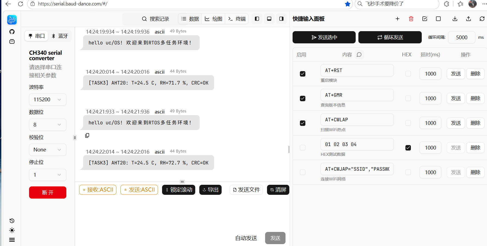

# STM32F103C8T6 + uC/OS-III + AHT20 实验工程

本工程对应实验报告中的任务一、任务二（3）：

- **Task1**：PC13 板载 LED，1 s 周期（亮 0.5 s / 灭 0.5 s）。
- **Task2**：PB12 外接 LED，3 s 周期（亮 1.5 s / 灭 1.5 s）。
- **Task3**：每 2 s 读一次 AHT20，USART1 输出问候语和温度/湿度。
- **RTOS**：uC/OS-III V3.01.2，Cortex-M3 RealView 移植层。
- **HAL**：STM32F1xx HAL，Keil MDK5 + ARMCC 5.06（AC5）。
- **I2C**：硬件 I2C1，PB6=SCL，PB7=SDA，100 kHz，AHT20 7 位地址 0x38。
- **串口**：USART1，PA9=TX，PA10=RX，115200-8-N-1。

> 实验报告：[嵌入式RTOS与I2C实验报告.pdf](嵌入式RTOS与I2C实验报告.pdf)


## 1. 直接烧录

`flash/RTOS_AHT20.hex` 是已经编译好的固件，可直接用 ST-Link + STM32CubeProgrammer 烧录：

```powershell
STM32_Programmer_CLI.exe -c port=SWD -w flash\RTOS_AHT20.hex -v -rst
```

BOOT0 = 0，复位后从 Flash 启动。

## 2. Keil 打开与编译

1. 打开 `MDK-ARM/RTOS_AHT20.uvprojx`。
2. 编译器选择 **ARM Compiler 5（ARMCC）**。工程已经按 AC5 配置；若你的 Keil 只装了 AC6，请安装 AC5 或改成 AC6 并替换 uC/OS 的汇编移植文件。
3. `Options for Target → Debug` 选择 ST-Link Debugger，Port 选 SW。
4. `Options for Target → Flash Download` 勾选 `Reset and Run`。
5. F7 编译，F8 下载。

编译结果（本机）：

```text
Code = 14088 B, RO-data = 384 B, RW-data = 76 B, ZI-data = 8028 B
Flash 约 14.2 KB / 64 KB
RAM   约 7.9 KB / 20 KB
0 Error(s), 0 Warning(s)
```

## 3. 接线

| STM32F103C8T6 | 外设 | 说明 |
|---|---|---|
| 3.3 V | AHT20 VCC | 必须 3.3 V，AHT20 与 LED 共地 |
| GND | AHT20 GND | 共地 |
| PB6 | AHT20 SCL | I2C1 SCL，100 kHz，模块自带 4.7 kΩ 上拉时可直接接 |
| PB7 | AHT20 SDA | I2C1 SDA |
| PC13 | 板载 LED | 低电平点亮，1 s 周期 |
| PB12 | 外接 LED | PB12 → 330 Ω → LED → GND，高电平点亮，3 s 周期 |
| PA9 | USB-TTL RX | 115200-8-N-1 |
| PA10 | USB-TTL TX | 可不接 |
| GND | USB-TTL GND | 必须共地 |

> 若 AHT20 模块没有上拉电阻，SCL/SDA 各接 4.7 kΩ 到 3.3 V。

## 4. 串口现象

串口助手设置为 **115200、8 数据位、1 停止位、无校验、UTF-8 编码**。正常输出：

```text
BOOT: STM32F103C8T6 / uC/OS-III / AHT20
I2C1: PB6=SCL, PB7=SDA, 100 kHz; AHT20 addr=0x38
...
[TASK3] AHT20 init OK
hello uc/OS! 欢迎来到RTOS多任务环境！
[TASK3] AHT20: T=25.0 C, RH=50.0 %, CRC=OK
```

如果中文乱码，把串口助手编码改成 UTF-8；不要用 GBK 打开 UTF-8 源码字符串。

实测截图（CH340 + 浏览器串口助手，115200-8-N-1，UTF-8）：



## 5. 工程结构

```text
RTOS_AHT20/
├─ Core/
│  ├─ Inc/  main.h board.h app.h aht20.h bsp_i2c.h bsp_uart.h ...
│  └─ Src/  main.c app.c aht20.c bsp_i2c.c bsp_uart.c stm32f1xx_it.c ...
├─ Drivers/                  STM32F1 HAL + CMSIS
├─ uCOS_III/
│  ├─ uCOS_CONFIG/           os_cfg.h / os_cfg_app.h / cpu_cfg.h ...
│  ├─ uCOS_CPU/              cpu_core.c / cpu_a.asm / cpu_c.c
│  ├─ uCOS_III/Ports/        os_cpu.h / os_cpu_a.s / os_cpu_c.c
│  ├─ uCOS_III/Source/       os_core.c / os_task.c / os_time.c ...
│  └─ uCOS_LIB/              lib_*.c
├─ MDK-ARM/                  Keil 工程 + startup_stm32f103xb.s
├─ flash/RTOS_AHT20.hex      可直接烧录
├─ report_assets/            报告插图（含串口实测截图）
└─ 嵌入式RTOS与I2C实验报告.pdf
```

## 6. 关键移植点

1. `startup_stm32f103xb.s` 的 PendSV 向量改为 `OS_CPU_PendSVHandler`，并 `IMPORT` 该符号。
2. `SysTick_Handler()` 先 `HAL_IncTick()`，再在 `OSRunning == OS_STATE_OS_RUNNING` 时调用 `OS_CPU_SysTickHandler()`。
3. 起始任务中调用 `OS_CPU_SysTickInit(SystemCoreClock / OSCfg_TickRate_Hz)`；本工程 `OS_CFG_TICK_RATE_HZ = 1000`。
4. `OSInit()` → 创建起始任务 → `OSStart()`；起始任务创建 3 个应用任务后 `OSTaskSuspend()` 自己。
5. AHT20 驱动内部通过 `aht20_delay_ms()` 延时；RTOS 下强定义为 `OSTimeDlyHMSM()`，避免 `HAL_Delay()` 阻塞其他任务。
6. I2C 时钟 100 kHz（标准模式），AHT20 地址 0x38，写 0x70、读 0x71。

## 7. 常见问题

- **卡在 OSStart / HardFault**：检查 PendSV 向量、`OS_CPU_SysTickInit()`、任务栈大小。
- **OSTimeDly 不返回**：SysTick 没有交给 uC/OS，检查 `SysTick_Handler`。
- **AHT20 初始化失败**：检查 3.3 V、GND、PB6/PB7、上拉电阻；用 `bsp_i2c_scan()` 扫地址。
- **读数 0xFF/0x00**：检查 status.bit7 忙标志和 80 ms 转换等待。
- **中文乱码**：串口助手设 UTF-8；源文件本身是 UTF-8。
- **Keil 编译报 A1516E**：startup 文件被保存成了带 BOM 的 UTF-8，需保存为无 BOM。
- **AC6 编译汇编报错**：本工程用 AC5；AC6 需要改用 GNU 语法移植文件。

## 8. 说明

- uC/OS-III 源码版权归 Micrium/Straight Up 所有，仅用于课程学习，不要用于商业再分发。
- HAL/CMSIS 版权归 STMicroelectronics / ARM，许可证文件保留在 `Drivers/` 下。
- 工程未使用 OLED；任务三只需 AHT20 + 串口。
